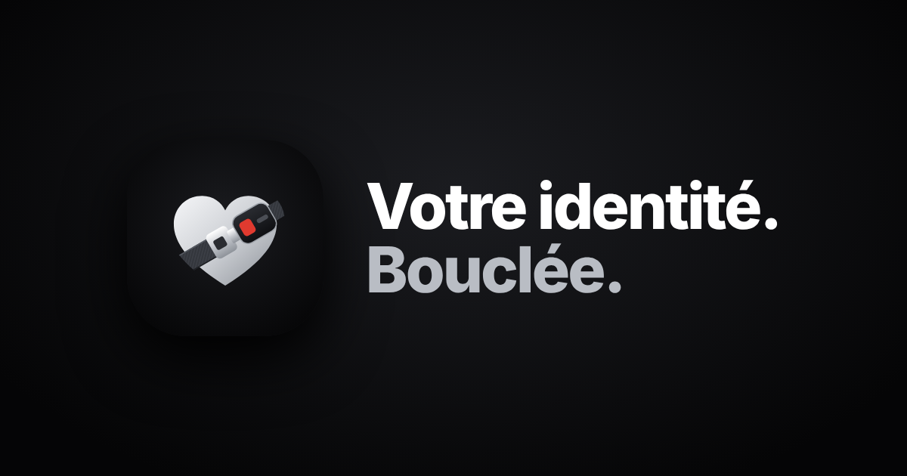
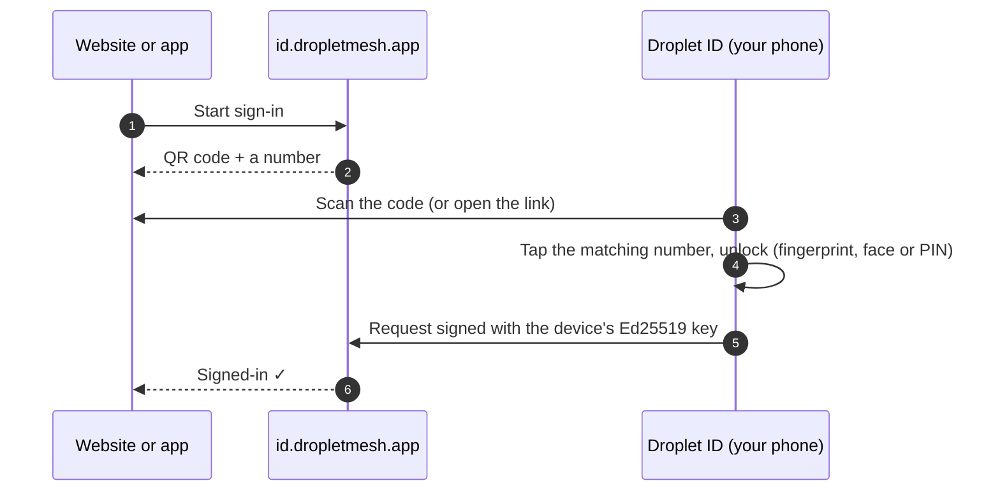

<div align="center">


# Droplet ID

**Your identity, buckled to your phone.**

Sign in to apps and websites with one gesture — no password, no e-mail, no phone number.

[](https://github.com/rito27959-arch/Droplet-id/actions/workflows/compiler.yml)


[**Website**](https://dropletid.dropletmesh.app) &nbsp;·&nbsp; [**How it works**](https://dropletid.dropletmesh.app/fonctionnement/) &nbsp;·&nbsp; [**Security**](https://dropletid.dropletmesh.app/securite/) &nbsp;·&nbsp; [**Developers**](https://dropletid.dropletmesh.app/developpeurs/)

<br>



</div>

<br>

## Overview

Droplet ID is the native Android app behind **“Continue with Droplet ID”**. Your identity is a key created on your phone; it never leaves it. Approving a sign-in takes a scan, a number and your fingerprint.



## What the app does

| | |
|:--|:--|
| **Create your Droplet ID** | An Ed25519 key is generated on the phone. The service only receives the public key and the phone model. |
| **Approve a sign-in** | Scan the site's code, tap the number shown, unlock. The request is signed by the device key. |
| **See and revoke access** | Every connected app, what it receives, and removal in two gestures. |
| **Security** | The phone's real state — screen lock, biometrics, StrongBox — with recommended actions, and *Forget Droplet ID on this phone*. |
| **Settings** | Appearance, reduced transparency, language and notifications, what is stored, licences. |

The API is the production service shared with the Droplet ID module of the Droplet messenger. The signed-request protocol is documented in [`Protocole.kt`](app/src/main/java/app/dropletmesh/id/donnees/Protocole.kt).

## Design

- **Palette — black and silver**, taken from the logo: a silver heart wrapped and sealed by a seatbelt, with a single red buckle button. Red is otherwise reserved for alerts and destructive actions. Tokens live in `core/designsystem/.../Couleurs.kt`.
- **Components — [Glasmio](https://github.com/NEORUAA/Glasmio) 0.1.4** (Apache-2.0): glass tab bar that compacts on scroll, large-title pages, grouped lists, alert dialogs, elastic iOS-style overscroll.
- **Type — Inter and Inter Tight**, variable fonts under SIL OFL 1.1, bundled with the app ([`licences/`](licences)).
- **Motion** — an opening sequence that buckles the logo, a five-page onboarding, staggered list groups. Everything respects *Remove animations*.

## Security model

- The Ed25519 seed is encrypted with Tink (AES-256-GCM) under a master key held in the Android Keystore. It is never transmitted.
- App data is excluded from backups and device-to-device transfers. Cleartext traffic is disabled.
- No secret ships in the repository or the APK — no API key, no client secret.
- **Known limit:** the server does not yet verify biometrics. Unlocking currently guards the approval screen; binding the signing key to user authentication requires the server to accept a Keystore-backed key. That is the next server-side step.

## Not built yet

Account recovery from another device, server-side passkeys, sign-in history, sessions and verifiable identity (SD-JWT) need new server APIs. The app says so honestly — for example *Recovery: not available yet* — rather than showing placeholder data.

## Build

Requires JDK 21 and the Android SDK (platform 37).

```sh
./gradlew :app:assembleDebug :app:testDebugUnitTest :core:designsystem:testDebugUnitTest
```

Every push to `main` builds the APKs in CI and publishes them to the [`telechargements`](../../tree/telechargements) branch; UI captures are published to [`captures`](../../tree/captures).

<details>
<summary><strong>Repository layout</strong></summary>

<br>

| Path | Contents |
|:--|:--|
| `app/` | The Android app: onboarding, account, apps, security, approval, scanner |
| `core/designsystem/` | Colours, type, icons, the seatbelt logo (`LogoCeinture`), shared components |
| `site/` | The Astro website at [dropletid.dropletmesh.app](https://dropletid.dropletmesh.app) |
| `licences/` | Third-party licences bundled with the app |

</details>

<br>

<div align="center">
<sub>
<a href="https://dropletmesh.app">Droplet</a> &nbsp;·&nbsp;
<a href="https://dropletid.dropletmesh.app">Droplet ID</a> &nbsp;·&nbsp;
<a href="https://drop.dropletmesh.app">Droplet Drop</a> &nbsp;·&nbsp;
<a href="https://web.dropletmesh.app">Droplet Web</a>
<br><br>
Designed and built in Yaoundé, Cameroon.
</sub>
</div>
